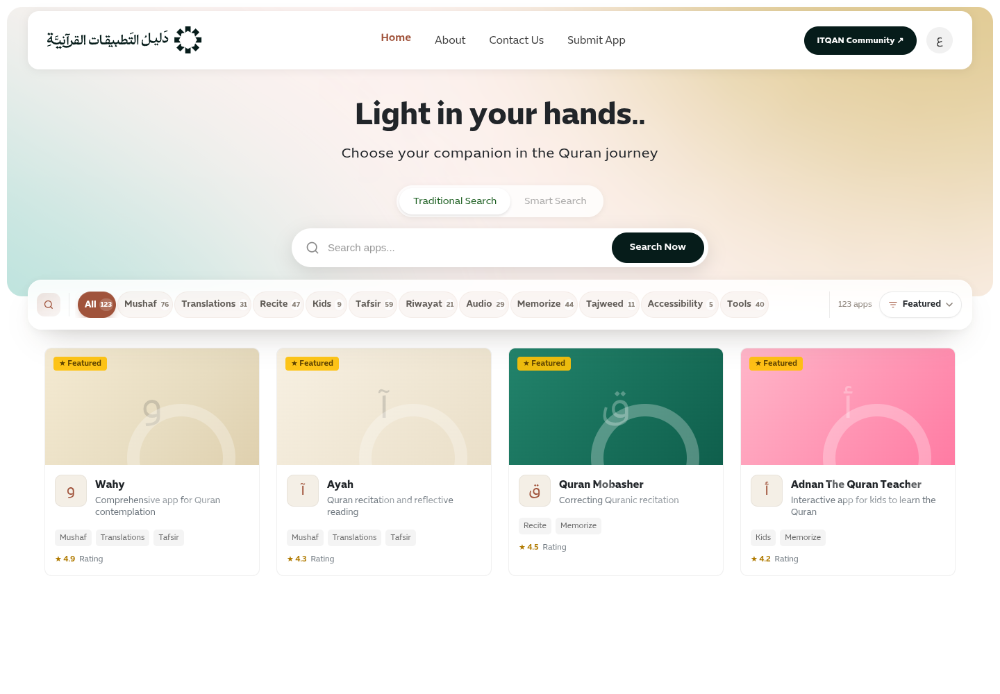
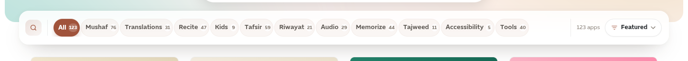
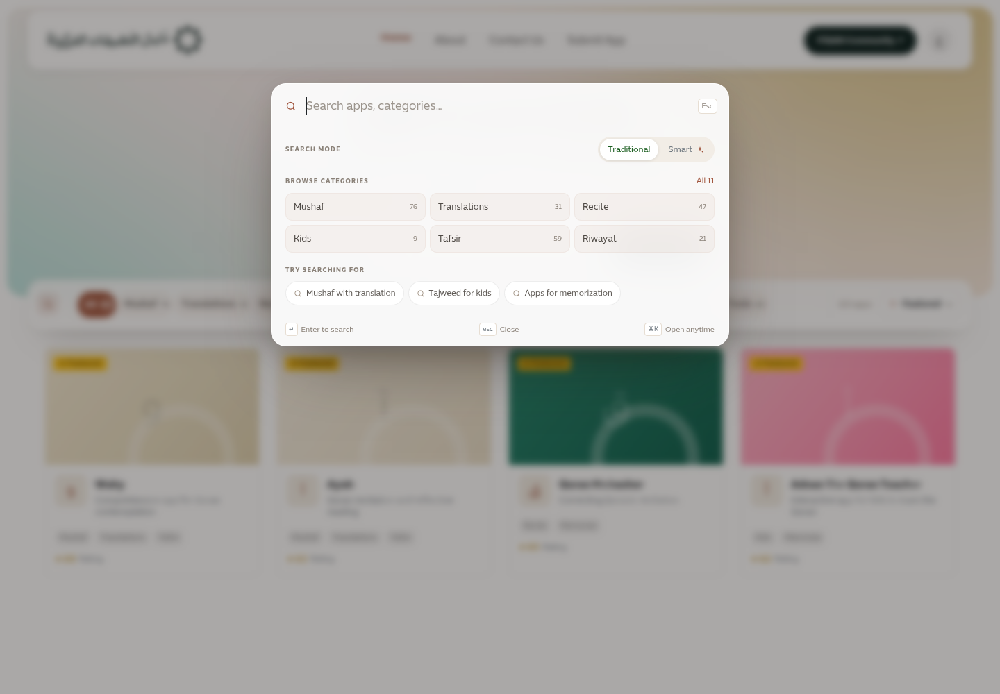
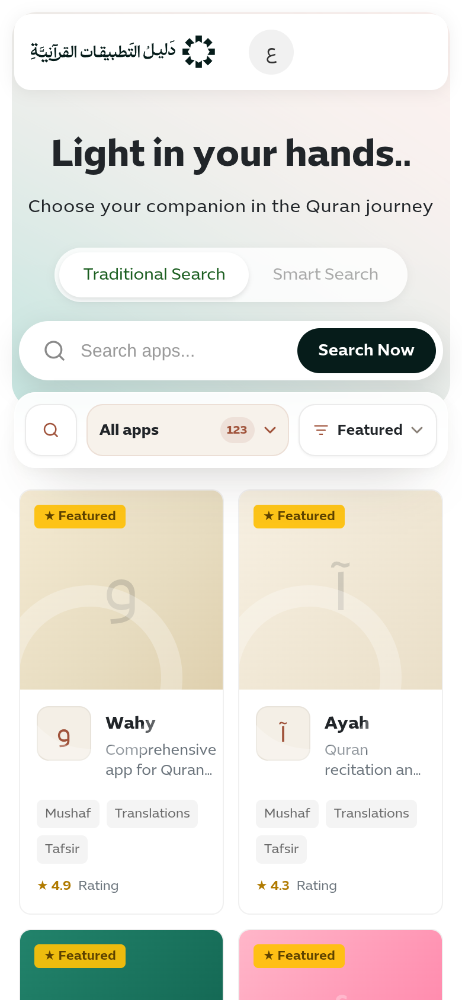
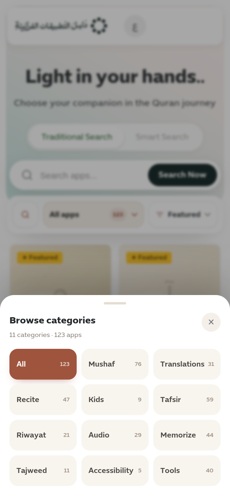
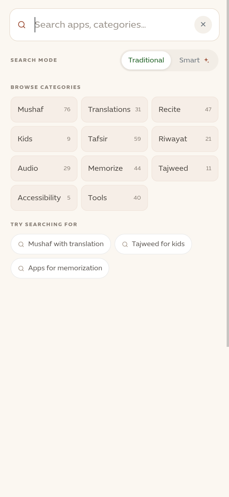

# Category Dock + Spotlight Search — Design

**Date:** 2026-10-28
**Status:** Design approved in chat; written spec pending review
**Feature area:** Public listing pages (`/`, `/[category]`, `/apps`) and the compact header

> **Amendment 2026-10-30 (header):** the fixed header is now a full-width, flat
> bar — `--header-h` (72px desktop / 64px mobile) plus the safe-area inset, a
> hairline bottom border and no floating card — and it never changes on scroll:
> the compact search bar and its `data-header-compact` scroll connector were
> removed, and page content is offset by `.site-main`. Statements below about
> the floating card, the compact swap or a dock pinned "below the compact
> header" are superseded; the dock now pins at `--header-h + 8px`.

## 1. Context

The public listing pages render a 12-chip category row inside the hero (`All` plus
11 categories with icons) and a separate toolbar below the hero containing the
result count and the sort select. Commit `c308410` made category links preserve
`?sort=`; the toolbar and pager stay on the current route. On mobile the chip row
clips horizontally with no affordance, and the fixed compact header carries a
third category UI (five chips plus a “More” dropdown). The hero search is the
only search entry and scrolls out of view.

The approved direction replaces the hero chip row with a floating index dock that
carries the categories, counts and sort. The left mark of the dock becomes a
search button that opens a Spotlight-style launcher. The hero keeps its large
search. Mobile uses the dock plus a bottom sheet for categories; search opens a
full-screen surface.

## 2. Goals and non-goals

**Goals**

- One category surface: the hero chip row and the compact-header category chips
  are removed.
- All 11 categories plus `All` visible at 1440px; the rail scrolls with an
  inline-end fade at narrower widths.
- Sort is contextual, visible with the active category, and always available.
- A persistent search shortcut once the hero search scrolls away.
- All categories reachable on mobile without clipped horizontal chips.
- Preserve the `?sort=` contract and the existing traditional/smart search flow.
- Accessible, RTL-correct, dark-mode and reduced-motion safe.

**Non-goals**

- Live search results while typing, or a new public search endpoint.
- Changes to the hero title/subtitle or the hero search.
- App card, pagination or category-page content redesign.
- Admin changes.
- Removing the compact header search input (only its category chips go).

## 3. Current behavior and constraints

- `src/components/apps/apps-listing.tsx` renders the hero, the category chips and
  `<Suspense fallback={<ListingCardsSkeleton />}>` around `ListingResults`.
- `ListingResults` computes `{ count, results, suggestedQuery, fallbackMode }`
  from `getAppsCached` or `getSmartAppsCached`, then renders the search-results
  header, the optional `.listing-toolbar` (`showSort`), the grid and pagination.
- Home (`/`), category (`/[category]`) and `/apps` (search results) all pass
  `showSort`; `/apps` owns `?search=` and `?mode=smart` and applies `?sort=` to
  both paths (SQL ordering for traditional search, the same order applied to
  the relevance-cut set for smart search).
- `SortSelect` routes to `basePath`, rewriting only `?sort=` and dropping the
  page param: `search`, `mode` and the facet params are carried over.
- Category chips use `/{lang}/{slug}?sort=…`; `All` uses `/{lang}?sort=…`.
- `getCategoriesCached()` returns `CategoryItem[]` including `appCount`, `icon`,
  `nameEn` and `nameAr`.
- `CompactSearch` is inside the fixed header and is only shown at desktop widths
  (`min-width: 993px`). `SiteHeader` fetches categories only for those chips.
- The compact header card is 64px tall at `top: 10px` inside 16px header padding;
  its visible bottom edge is about 90px from the viewport top.
- E2E currently relies on `getByLabel("Sort by")` and the `.categories-chips`
  container.

## 4. Chosen design

### 4.1 Floating category dock

- Rendered after the hero, with a negative top margin (about 34px desktop, 24px
  mobile) so it bridges the hero’s bottom edge.
- Max width aligned with the header card (`1392px` including `16px` side
  padding), height `72px` desktop / `64px` mobile, radius `20px` / `18px`.
- Sticky below the fixed header. The header stays above the dock
  (`#site-header` z-index 1000, dock z-index 40). The sticky top is about `98px`
  (header card bottom at ~90px + 8px gap); verify against the real header.
- Surface: translucent white glass, 1px light border, soft drop shadow,
  `backdrop-filter: blur(18px) saturate(1.1)`.

**Desktop contents**

1. Search button: 34px rounded square, magnifier, replaces the former decorative
   grid mark. No width cost; the 12-chip rail still fits at 1440.
2. Category rail: `All` plus the 11 categories. Each item is a pill with a name
   and a counter badge. The active pill is the only solid brown fill.
3. Utility zone: result count and the sort pill, separated by a hairline.

**Chip treatment**

- Unselected: warm translucent surface (`rgba(160,83,59,.055)`), 1px inset
  hairline (`rgba(160,83,59,.06)`), 13px medium name, 18px white counter capsule
  with tabular numerals. Hover warms the surface, strengthens the hairline and
  lifts the chip slightly.
- Active: `--primary-color` fill (`#A0533B` light), white 600 text, translucent
  white counter (`rgba(255,255,255,.18)`), soft shadow, `aria-current="page"`.
- Counts: category counts come from `appCount`. The `All` chip shows the current
  result count only when `All` is the active context (home and `/apps`); on a
  category page it has no count, because the result count is that category’s
  count. The utility count always shows the current result count. A null count
  (streaming fallback) renders a fixed-width shimmer instead of text.
- Rail overflow: horizontal scroll, hidden scrollbar, inline-end mask fade. At
  1440 all 12 fit without overflow; at narrower widths the last chips scroll.

**Sort**

- A white pill with the sort glyph, the selected option label and a chevron.
- The native `<select>` sits transparent over the pill so keyboard and screen
  readers keep the native control. The accessible label is the existing
  `appList.sort.label` (“Sort by”).
- Rendered when `showSort` is true — every listing route, search results
  included. On `/apps` the chosen order persists across a new search (the hero
  form and the palette submit carry `?sort=`), and smart search presents its
  relevance-cut matches in that order (the default keeps relevance order).

### 4.2 Mobile category sheet

- The mobile dock has a 44px search button, a 44px category trigger and, when
  `showSort`, the sort pill. The category trigger shows the active category (or
  “All apps”), its count badge and a chevron.
- Tapping the trigger opens a bottom sheet implemented as a native `<dialog>`
  with `showModal()`:
  - Bottom-aligned panel, 24px top radius, white surface, drag handle.
  - Header “Browse categories”, category count, close button.
  - 3-column grid of 12 tiles (All + 11), each at least 52px tall; active tile
    is brown with white text and a translucent count.
  - Selecting a tile navigates to that category and closes the sheet.
  - Esc, backdrop click or the close button closes it; focus returns to the
    trigger; body scroll is locked while open.

### 4.3 Spotlight search palette

- The dock search button opens a native `<dialog>` centered on desktop
  (660px wide, 12vh from the top, 22px radius, glass surface) and full-screen on
  mobile (warm paper surface, input row at the top, close button).
- Contents:
  - Search input, autofocused, placeholder “Search apps, categories…”.
  - `Traditional` / `Smart` segmented control, default Traditional.
  - Six category shortcuts on desktop, all 11 on mobile, each with a count and a
    link that preserves the current `?sort=`. “All categories” on desktop closes
    the palette; the dock rail already holds the full index.
  - Three localized example queries; clicking one submits it immediately with
    the selected mode.
  - Footer hints: Enter to search, Esc to close, ⌘K to open.
- Submit closes the palette and navigates to
  `/{lang}/apps?search=<encoded>` plus `&mode=smart` when Smart is selected.
  An empty query does nothing.
- Closing on Esc, backdrop or X returns focus to the search button and unlocks
  body scroll. The ⌘K / Ctrl+K shortcut opens the palette from the listing and
  is ignored when the event target is an input, textarea or contenteditable.
- **Launcher only.** No live app results, no debounce, no new API. The existing
  results page performs the search. Live results are a later change behind the
  same panel.

### 4.4 Hero and compact header

- Remove the category chip row from the hero. Title, subtitle and hero search
  stay.
- Remove the five category chips, the “More” dropdown and the `keepSort` logic
  from `CompactSearch`. The compact search input and submit button remain.
- Remove `getCategoriesCached()` and the categories prop from `SiteHeader`; the
  header no longer needs category data.

### 4.5 Streaming and loading

- `ListingCardsSkeleton` renders the real `CategoryDock` with `count={null}`
  above the card skeletons. The dock remains visible, interactive and sticky
  while results stream; the All chip and result count show a fixed-width
  shimmer until the real count arrives.
- The real `ListingResults` renders the same dock with the result count. The
  search-results header, smart-search notices, grid and pagination remain below
  the dock inside `.main-content`.

## 5. Visual system

Use the existing brand tokens where possible. New dock/palette tokens:

| Token | Light | Dark |
| --- | --- | --- |
| `--dock-surface` | `rgba(255,255,255,.84)` | `rgba(24,24,24,.84)` |
| `--dock-border` | `rgba(255,255,255,.72)` | `rgba(255,255,255,.08)` |
| `--dock-chip` | `rgba(6,28,26,.045)` | `rgba(255,255,255,.06)` |
| `--dock-chip-line` | `rgba(6,28,26,.07)` | `rgba(255,255,255,.10)` |
| `--dock-chip-text` | `#5C5C5C` | `#D6D0C8` |
| `--dock-chip-active` | `var(--cta-color)` (`#061C1A`) | `#F2F5F3` |
| `--dock-chip-active-text` | `#FFFFFF` | `#0F0F0F` |
| `--dock-num` | `rgba(255,255,255,.72)` | `rgba(255,255,255,.10)` |
| `--dock-num-text` | `#6C757D` | `#B3B3B3` |
| `--dock-num-active` | `rgba(255,255,255,.16)` | `rgba(15,15,15,.12)` |
| `--dock-sheet` | `#FFFFFF` | `#1E1E1E` |
| `--dock-sheet-tile` | `#F5F5F5` | `#262626` |
| `--dock-sheet-active` | `var(--cta-color)` (`#061C1A`) | `#F2F5F3` |
| `--palette-surface` | `rgba(255,255,255,.93)` | `rgba(28,28,28,.94)` |
| `--palette-backdrop` | `rgba(20,15,10,.36)` | `rgba(0,0,0,.55)` |

- Type: Expo Arabic. Dock names 13px/500, active 600; counters 9.5px/600 with
  tabular numerals; sort 12.5px/500; palette input 16.5px; section labels 9px/700
  with 0.14em tracking; mobile names 12.5–13px.
- Motion: 0.18s ease for chips/palette; 0.28s
  `cubic-bezier(.22,.8,.3,1)` for the sheet. Respect
  `prefers-reduced-motion: reduce` by removing transforms and transitions.
- Focus: 2px `--primary-color` ring, 2px offset, on all interactive dock,
  sheet and palette controls. Tap targets are at least 44px on mobile.
- The selected chip/tile uses the site's black-and-white button pairing (ink
  fill with white label, inverted on dark surfaces) — not the orange accent —
  and is flat: both its containers (`.dock-rail`, `.m-sheet-panel`) are scroll
  containers, so a drop shadow was clipped into a hard-edged blob.
- The active pill, counters and muted labels must meet 4.5:1 contrast for small
  text in both themes.

## 6. Architecture and data flow

```
page (home | category | apps)
  └─ AppsListing (server)
       ├─ hero (title, subtitle, HeroSearch)
       └─ Suspense
            ├─ fallback: ListingCardsSkeleton
            │    └─ CategoryDock count={null} + card skeletons
            └─ ListingResults (server)
                 ├─ CategoryDock count={count}  (client)
                 │    ├─ SearchPalette (client dialog)
                 │    ├─ SortSelect (client)
                 │    └─ mobile category sheet (client dialog)
                 └─ .main-content (search header, grid, pagination)
```

**New components**

- `src/components/apps/category-dock.tsx` (client): dock, chips, search button,
  mobile trigger/sheet, palette open state, ⌘K listener.
- `src/components/apps/search-palette.tsx` (client): native dialog, input, mode,
  category shortcuts, example queries, focus and scroll-lock behavior.
- `src/lib/listing-links.ts`: URL builders shared by the dock and palette.

**Changed components**

- `src/components/apps/sort-select.tsx`: same props and route behavior; new pill
  markup with a transparent native select.
- `src/components/apps/apps-listing.tsx`: remove hero chips and
  `CategoryIcon`/`SortSelect` usage; pass categories into `ListingResults` and
  the fallback.
- `src/components/apps/listing-skeleton.tsx`: accept the dock props and render
  the dock above the card skeletons.
- `src/components/site/compact-search.tsx`: remove category chips,
  `keepSort`, dropdown state and category imports.
- `src/components/site/site-header.tsx`: remove the categories fetch and prop.
- `src/app/globals.css`: add dock/palette/sheet styles and tokens; remove the
  old hero chip, listing toolbar, sort select and compact category styles.
- `src/i18n/en.json`, `src/i18n/ar.json`: new dock/palette/sheet labels.

`apps-listing.tsx` and `listing-skeleton.tsx` remain server components; the dock
and palette are the client boundary. `CategoryItem[]` is serializable.

## 7. Contracts

### URLs

- Category: `categoryHref(lang, slug, sort)` →
  `/{lang}/{slug}` plus `?sort=<encoded>` when sort is set and not `featured`.
- All: `categoryHref(lang, undefined, sort)` → `/{lang}` plus the same query.
- Search: `searchHref(lang, query, mode, sort?)` →
  `/{lang}/apps?search=<encoded>` plus `&mode=smart` for Smart and `&sort=` when
  a non-default sort is active. Empty query returns `/{lang}/apps`; the palette
  does not navigate on empty submit.
- Sort: `SortSelect` pushes `basePath` with the current query re-encoded, the
  page dropped and `?sort=<value>` set (`featured` omits the param), matching
  `c308410` plus param preservation.

### State

- URL is the source of truth for category, sort, search and mode. No global
  store.
- Dock state is local: `searchOpen`, `sheetOpen`.
- `All` is active when `selectedCategory` is absent (home and `/apps`). A
  category chip is active when `selectedCategory` matches its slug. An unknown
  category slug has no active chip (the `All` chip is not active either) and the
  mobile trigger falls back to “All apps”.
- `count` is the result count for the current listing (including search and
  smart search). Category chip counts are global `appCount` values. The `All`
  chip count is shown only when `All` is active; on a category page it is
  omitted. The utility count always shows `count`.
- Unknown category: no active chip, count 0, empty state below; the dock still
  renders.

### Internationalization

New keys under `appList` (English / Arabic):

- `categories.allApps` — “All apps” / “كل التطبيقات”
- `categories.browse` — “Browse categories” / “تصفح التصنيفات”
- `categories.allCategories` — “All categories” / “جميع التصنيفات”
- `categories.count` — “{count} categories” / “{count} تصنيفاً”
- `categories.close` — “Close categories” / “إغلاق التصنيفات”
- `search.paletteAria` — “Search apps” / “ابحث عن التطبيقات”
- `search.palettePlaceholder` — “Search apps, categories…” /
  “ابحث عن التطبيقات أو التصنيفات…”
- `search.mode` — “Search mode” / “طريقة البحث”
- `search.try` — “Try searching for” / “جرّب البحث عن”
- `search.suggestionMushaf` — “Mushaf with translation” /
  “المصحف مع الترجمة”
- `search.suggestionTajweed` — “Tajweed for kids” / “التجويد للأطفال”
- `search.suggestionMemorize` — “Apps for memorization” /
  “تطبيقات للحفظ”
- `search.enter` — “Enter to search” / “اضغط Enter للبحث”
- `search.openAnytime` — “Open anytime” / “افتح في أي وقت”
- `search.close` — “Close” / “إغلاق”
- `search.closeAria` — “Close search” / “إغلاق البحث”

Reuse existing `appList.search.traditional`,
`appList.search.smart`, `appList.sort.*` and `appList.categories.all`.

## 8. Accessibility, RTL, dark mode

- The rail is `<nav aria-label="{categories.title}">`; chips are links; the
  active chip has `aria-current="page"`.
- Search button: `aria-haspopup="dialog"`, `aria-expanded`, `aria-controls`.
  Mobile category trigger: same pattern for the sheet.
- Both overlays are native `<dialog>` elements opened with `showModal()`; they
  trap focus, sit in the top layer and close on Esc. Close buttons have labels.
- Opening either overlay locks body scroll; closing restores the previous focus
  and unlocks scroll. A route change closes the palette/sheet.
- The palette input is autofocused; mode buttons expose `aria-pressed`; example
  queries are buttons; category shortcuts are links.
- Use logical properties (`padding-inline`, `border-inline`, `inset-inline`) so
  the rail, fade, dividers, sheet grid and palette mirror in RTL. The
  inline-end fade flips direction.
- Dark mode uses the `.dark` class and the tokens in section 5.
- Reduced motion removes the sheet/palette transforms and chip transitions.

## 9. Testing strategy

**Unit (Vitest)**

- `tests/listing-links.test.ts` covers `sortQuery`, `categoryHref` and
  `searchHref`: feature omission, encoding, empty query, Smart mode, AR/EN.

**E2E (Playwright, built app on :3210)**

- Dock renders at `/en`; nav accessible name; `All` active with
  `aria-current="page"`; all category links present.
- Existing category + sort + pager test updated to click the dock’s `Mushaf`
  link; URL keeps `sort=newest`; sort select value is `newest`.
- `/en/apps?search=ayah`: dock visible with the sort pill; changing the sort
  keeps the search term and lands on `?search=ayah&sort=newest`.
- Unknown category: dock visible; no active chip.
- Search palette: open from the dock button; input has focus; submit “ayah” →
  `/en/apps?search=ayah`; Smart mode adds `mode=smart`; Esc closes and returns
  focus; category shortcut preserves `sort`; a category navigation closes the
  palette.
- Mobile (390px): category sheet opens, shows 12 category links, selecting
  Mushaf navigates and closes; Esc returns focus. Search opens full-screen with
  the input and close button visible; all 11 category links are present.
- Compact header no longer renders `.compact-category-chip`; the dock remains
  the only category surface.
- Narrow desktop (1024px): the rail overflows and the last category can be
  scrolled into view; the fade is applied.
- RTL (`/ar`): the dock and palette render; `html[dir="rtl"]`; active chip and
  sheet/palette are usable.
- `/apps` shows the sort pill like home/category; a smart search re-orders its
  matches when a non-default sort is chosen.

**Manual/visual**

- 1440, 1024, 390; EN and AR; light and dark; sticky scroll; palette; sheet;
  keyboard focus; reduced motion.
- The streaming fallback: the dock is visible with a shimmer count and its links
  and search work before cards arrive.

**Commands**

- `npm run lint`
- `npx vitest run tests/listing-links.test.ts`
- `npx playwright test e2e/public.spec.ts`
- The Playwright config builds the app and starts the standalone server on
  `:3210`; the dev DB must be seeded and reachable.

## 10. Alternatives considered

| Option | Why not |
| --- | --- |
| A. Browse shelf in the hero | Most visual discovery, but the hero becomes heavy, the icon noise returns, and sort stays separate. |
| C. Text index + context bar | Keeps both jobs but repeats the active category and does not couple sort as tightly. |
| B2. Flat paper index bar | Read as a toolbar; the flat strip and tiny rules felt dated. |
| S2. Inline dock search | Sleek, but hides categories while typing and duplicates the hero search unless the hero search is removed. |
| S3. Search-first dock | Cleanest single search, but removes the hero search and tabs — a landing-page redesign. |
| Live results in the palette | Better Spotlight feel, but needs a search endpoint, ranking, loading/empty/error states and keyboard result navigation. Deferred. |

## 11. Risks and decisions

- **Sticky offset:** the dock must pin below the fixed compact header, not at
  `top: 0`. Verify at desktop and mobile; the header card bottom is ~90px.
- **Header search duplication:** the compact header search input remains while
  the dock adds a search button. This is accepted; the dock is the richer
  persistent entry.
- **Count semantics:** the dock total is the current result count (search,
  smart search or listing). Category chip counts are global. This matches today.
- **Unknown categories:** no active chip; the trigger says “All apps”; count 0.
- **`All categories`:** closes the palette; the dock is the full index.
- **Example queries:** clicking submits immediately with the selected mode.
- **Fallback:** `count={null}` must never render `null`, `NaN` or `0`.
- **CSS cleanup:** the old `.categories-chips`, `.category-chip`,
  `.listing-toolbar`, `.sort-select*` and `.compact-category-*` rules must be
  removed only after checking for remaining references.
- **Dark contrast:** verify the active chip, counters and muted labels.

## 12. Out of scope

- Live search results, a new search API or ranking changes.
- Hero title/subtitle/search changes.
- App cards, pagination, category-page content or SEO.
- Admin.

## 13. Approved visual reference

Approved mockups at 1440px desktop and 390px mobile. The spec’s tokens, copy and
count semantics are authoritative where the mock uses earlier labels (for
example, the mock’s “All 11” is `All categories` in the spec).

**Desktop dock** — search button, chip rail, counter badges, sort pill, sticky
placement over the hero.



**Dock detail** — the unselected chip surface, counter capsule and active pill.



**Desktop search palette** — glass panel over the blurred page, mode control,
category shortcuts and example queries.



**Mobile dock** — search, category trigger and sort.



**Mobile category sheet** — 3×4 index with the active tile.



**Mobile search** — full-screen search with all categories.


